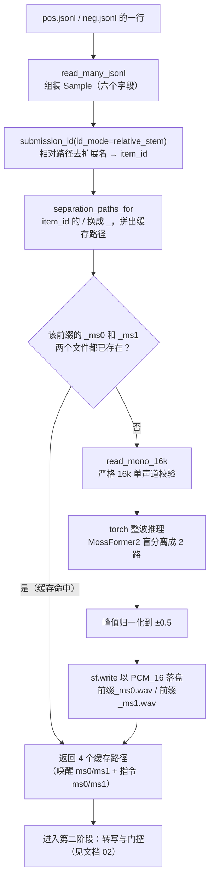

# 一条数据的流动全景（一）：样本加载与分离前端

> 本系列三篇文档回答同一个问题：**一条样本（一条数据）在系统里到底经历了什么**。
> 建议先读 `docs/代码库结构解读.md` 建立仓库全局地图，再按 01 → 02 → 03 的顺序阅读本系列。
> 本篇涉及的代码：`src/midea_qiji/infer.py`、`src/szy/helpers.py`、`src/szy/separator.py`。

## 本文档讲什么

本篇讲样本旅程的第一站：**从"清单文件里的一行"到"磁盘上的四条分离音频"**。具体包括：jsonl 清单如何被读成结构化对象、样本的唯一编号怎么来、唤醒/指令两段原始音频如何被 MossFormer2 盲分离成 ms0/ms1 两路并写入缓存，以及这些设计背后的"为什么"。

**数据在此阶段从「jsonl 里的一行」变成「4 个分离缓存 wav 文件」**（`outputs/szy_cache/separation/` 下的 `*_wake_ms0.wav`、`*_wake_ms1.wav`、`*_command_ms0.wav`、`*_command_ms1.wav`，外加内存中的一个 Sample 对象）。

## 1. 起点：jsonl 里的一行

系统入口是 `bash scripts/run.sh`，它等价于设置好环境变量后运行 `python -m szy.cli`。cli 启动后干的第一件事，是调用 `read_many_jsonl` 把一份或多份 jsonl 清单读进来。

jsonl（JSON Lines）是"每行一个独立 JSON 对象"的文本格式。竞赛数据用它当样本清单，是因为它逐行独立：断在哪儿都能接着读、追加样本不用重写整个文件、而且天生就是"一条样本一行"的结构。一行正样本长这样（示例）：

```json
{"id": "A001", "唤醒音频": "wake/A001.wav", "识别音频": "command/A001.wav", "识别文本": "打开空调", "唤醒文本": "你好美的"}
```

逐字段解释：

| 字段 | 含义 | 在系统中的去向 |
|---|---|---|
| `id` | 数据集自带的原始编号（可选） | 存为 `raw_id`，现役配置下不用于提交编号 |
| `唤醒音频` | 目标说话人说唤醒词（如"你好美的"）的音频相对路径 | 声纹参考——"目标人的声音长什么样" |
| `识别音频` | 需要转写的指令音频相对路径 | 待处理对象——可能混着目标人、干扰人和噪声 |
| `识别文本` | 标注（label），指令的正确文字 | 只有正样本有；评测时用来算 CER |
| `唤醒文本` | 唤醒词的标准文字（可选，也可写作 `wake_text`） | 后面用来从分离结果里找"说出唤醒词的那一路" |

负样本的区别只在于没有标注：`识别文本` 要么是空串、要么干脆缺省，例如（示例）：

```json
{"id": "B002", "唤醒音频": "wake/B002.wav", "识别音频": "command/B002.wav", "识别文本": ""}
```

所有相对路径都以 `--data-root`（run.sh 里是 `dataset/dataset_test/datasetA/datasetA`）为基准拼接成绝对路径，这样 jsonl 文件本身可以随意移动，只要数据根目录不变就能定位到音频。

## 2. 第一站 read_many_jsonl：一行 → Sample

`read_many_jsonl(paths, data_root)` 定义在 `midea_qiji.infer`，职责是把 jsonl 的每一行装进一个 `Sample` 对象。它的工作方式很朴素：

1. 逐个打开传入的 jsonl 文件，按行读取；
2. 跳过空行（清单文件末尾常见的多余换行）；
3. 对每一行 `json.loads` 解析成 dict；
4. 取出 `唤醒音频` 和 `识别音频` 两个必填字段。**缺任何一个都会立刻抛错**，错误信息里带着"文件名:行号"——宁可当场失败，也不让一条字段残缺的样本混进管线、在数小时后的评测阶段才露出马脚；
5. 用 `data_root / 相对路径` 拼出两个绝对路径，组装成 Sample。

`Sample` 是一个 `frozen dataclass`（创建后不可修改），共六个字段：

```python
Sample(
    raw_id="A001",                                    # jsonl 里的 id 字段（可为空串）
    wake_audio=Path("dataset/dataset_test/datasetA/datasetA/wake/A001.wav"),   # 唤醒音频绝对路径
    command_audio=Path("dataset/dataset_test/datasetA/datasetA/command/A001.wav"),  # 指令音频绝对路径
    command_relative_path="command/A001.wav",         # 指令音频相对路径（原样保留）
    label="打开空调",                                  # 标注文本；None 或空串 = 负样本
    wake_text="你好美的",                              # 唤醒词文字；可为 None
)
```

为什么要把一行 dict 换成 dataclass？三个理由：一是**字段固定**，类型检查器能帮你发现拼错的字段名；二是**不可变**，`frozen=True` 保证样本在整条管线里被十几处函数传阅时不会被谁意外改坏；三是**自解释**，看到 `sample.command_audio` 就知道它是路径，不需要翻 jsonl 确认字段名。

注意 `label` 的两种"没有标注"：字段缺失时是 `None`，字段存在但为空串时是 `""`。两者在后面的评测里都算负样本。

## 3. 第二站 submission_id：Sample → item_id

样本进入管线后，第一件事是拿到自己的**唯一编号**，因为缓存文件命名、checkpoint 去重、提交文件的 id 全部依赖它。生成编号的函数是 `submission_id(sample, mode)`，支持六种口径：

| id_mode | 结果（以上面的 A001 为例） | 取法 |
|---|---|---|
| `raw` | `A001` | jsonl 里的 id 字段原样 |
| `name` | `A001.wav` | 指令音频文件名 |
| `path` | `dataset/dataset_test/datasetA/datasetA/command/A001.wav` | 绝对路径 |
| `relative` | `command/A001.wav` | 相对路径原样 |
| **`relative_stem`** | **`command/A001`** | **相对路径去掉扩展名** |
| `stem` | `A001` | 文件名去掉扩展名 |

现役配置 `configs/pipeline_firered.json` 里写的是 `"id_mode": "relative_stem"`，实现只有两行：

```python
path = Path(sample.command_relative_path)
return (path.parent / path.stem).as_posix()
```

即：取相对路径、去掉 `.wav` 扩展名、保留目录部分。**为什么竞赛要这个口径？** 因为官方评测按"识别音频相对路径去扩展名"来认样本——你提交的 json 里每条结果的 `id` 必须与官方口径一字不差，评测程序才能把你的输出对回它的标注。如果随便用自己的编号，交上去的结果会因为对不上号而全部作废。

## 4. 第三站 separation_paths_for：item_id → 缓存路径

拿到 item_id 后，`szy.helpers.separation_paths_for` 负责回答一个问题：**这个样本的分离结果应该存在哪里？** 签名是 `separation_paths_for(sample, id_mode, cache_dir, separator)`，它做两件事：

1. 用 `submission_id` 算出 item_id，再把其中的 `/` 全部替换成 `_`（因为 item_id 可能带目录层级，不能直接当文件名用）；
2. 用"前缀 + 后缀"拼出四个路径，并把实际分离工作委托给传入的 `separator`。

落盘命名规则（以 `command/A001` 为例）：

```
item_id                command/A001
替换 / 后              command_A001
唤醒前缀                outputs/szy_cache/separation/command_A001_wake
指令前缀                outputs/szy_cache/separation/command_A001_command

最终四个文件：
  command_A001_wake_ms0.wav      唤醒音频分离出的第 0 路
  command_A001_wake_ms1.wav      唤醒音频分离出的第 1 路
  command_A001_command_ms0.wav   指令音频分离出的第 0 路
  command_A001_command_ms1.wav   指令音频分离出的第 1 路
```

缓存根目录来自配置的 `separation_cache`，默认 `outputs/szy_cache/separation`；配置里写的是相对路径时，会在运行时以当前工作目录为基准解析成绝对路径（run.sh 会先 `cd` 到仓库根目录，所以实际落在仓库的 `outputs/` 下）。

两个值得注意的设计：

- **路径只由 item_id 决定**，与运行环境、批次顺序、今天星期几统统无关。同一个样本在任何一次运行里都映射到同一个缓存路径——这是"缓存能命中"的前提。
- **`separator` 是当参数传进来的**，而不是在 helpers 里直接 import。`helpers.py` 因此完全不需要 torch 就能被 import，轻量环境（比如跑单元测试）也能用它的全部函数。

值得留意：`separation_paths_for` 自己**不判断缓存是否命中**，它把这一判断连同"缓存未命中就真跑分离"一起，委托给了 `separator.separate()`——下一站的主角。

## 5. 第四站 MossFormer2Separator.separate：路径 → 4 个 wav

`MossFormer2Separator` 定义在 `szy.separator`，是产线唯一的分离器实现。它把一段**混合语音盲分离成两路**（ms0/ms1）：模型是 MossFormer2_SS_16K，权重是 `model/artifacts/mossformer2_dasynth_sweep_ep6.pt`（在 dataset_dasynth 上做过域适配微调，修复了官方分离器在混响/掩盖样本上崩溃的问题）。

### 5.1 延迟导入：为什么不在文件顶部 import

`szy.separator` 这个模块在 import 的那一刻，就会把仓库的 `third_party/` 目录插进 `sys.path` 并引入 mossformer2 的模型定义代码——而模型定义依赖 torch。如果管线模块在顶部直接 `from szy.separator import MossFormer2Separator`，那么**任何** import 管线模块的行为（包括 `python -m szy.cli --help` 和单元测试）都会连带要求装好 torch。

所以 `szy.pipeline` 把它推迟到 `SzyRunner.__init__` 里、真正要用分离器的时候才 import。这样命令行帮助、配置校验、纯 numpy 的单测在没有 torch 的环境里照样能跑。这是一个通用工程习惯：**重型依赖延迟导入，把"能不能启动"和"能不能干活"分开**。

### 5.2 模型装配 load_mossformer2

装配时用与官方预训练一致的超参数构造模型：`num_spks=2`（分离成两个说话人）、`encoder_kernel_size=16`、`encoder_embedding_dim=512`、`mossformer_sequence_dim=512`、`num_mossformer_layer=24`。加载 .pt 权重时用 `strict=True`：权重文件的键只要有一个对不上就立刻报错——**宁可报错，也不静默漏加载**（漏加载意味着模型悄悄用了随机初始化的那一层，结果全部不可信且难以排查）。

模型最后被放到设备上（配置里的 `cuda:0`；若请求 cuda 但机器没有 CUDA 则回退 cpu）并切到 `eval()` 模式——关闭 dropout 等只在训练时生效的随机行为，保证推理结果可复现。

### 5.3 缓存命中判断：两个文件都齐才算命中

`separate(source, output_prefix)` 的第一步是拼出两个输出路径（`前缀_ms0.wav` 和 `前缀_ms1.wav`），然后检查：**两个文件是否都已经存在**。都存在 → 直接返回路径，分离模型一次都不碰；只要缺一个 → 重新分离并覆写。也就是说，缓存命中是"全有或全无"的，不会出现"只用了半个旧结果"的脏状态。

### 5.4 read_mono_16k：严格 16k 校验

没命中缓存时，分离器用 `szy.helpers.read_mono_16k` 读取源音频。这个函数是分离器的**唯一输入口径**，校验很严格：

1. 用 soundfile 读取为 float32 波形（`always_2d=False`，单声道时直接得到一维数组）；
2. **采样率必须正好是 16000**，不是就抛 `ValueError`——不重采样、不迁就。因为竞赛数据口径固定 16k，如果哪天冒出一个 48k 的文件，那一定是数据或流程出了问题，悄悄重采样只会把问题掩盖掉、还引入失真；
3. 如果是双声道，取两声道均值混成单声道（读到的源音频绝大多数是单声道，这是对意外情况的温和兜底）；
4. 波形为空、或含 NaN/Inf，同样直接报错——喂给神经网络的必须是干净的有限数值。

### 5.5 torch 整波推理

读进来的波形是 float32 的一维数组，随后：

```python
with torch.no_grad():
    out = self.model(torch.from_numpy(waveform).float().to(self.device)[None, :])
```

三步拆开看：`torch.from_numpy(...).float()` 把 numpy 数组变成 torch 张量并搬到设备上；`[None, :]` 在开头加一维，从 `(T,)` 变成 `(1, T)`——因为模型是按 batch 维设计的；`torch.no_grad()` 关掉自动求导，纯推理不建计算图，省下一大块显存。整段音频一次性前向，输出形状为 `(2, T)` 的两路估计。

### 5.6 峰值归一化到 ±0.5，PCM_16 落盘

对每一路输出做三件事：

1. 取出 `(1, T)` 中的第 1 维，转回 numpy float32；
2. **峰值归一化**：除以整段波形的最大绝对值再乘 0.5，把波形缩放到 **[-0.5, 0.5]**。为什么是 0.5 而不是 1.0？一是与历史 ONNX 分离器的输出口径保持逐字一致（换实现不换数据形态）；二是留出余量防止爆音——后续任何增益处理都不会让采样点越过 1.0 造成削波；
3. 用 soundfile 以 **PCM_16（16 位整型）、16000 Hz** 写盘。

为什么要写成 PCM_16？因为第二阶段的门控用 `midea_qiji.audio.read_wav` 读音频，而它用标准库 wave 模块**严格要求 16k 单声道 PCM16**（内部把 int16 除以 32768 还原成 [-1, 1] 的浮点）。分离产物只有写成这个格式，才能被下游用同一口径直接读回。

### 5.7 soundfile 在此处的三种用法

这一站里 soundfile（`import soundfile as sf`）一共露了三面：

| 用法 | 位置 | 作用 |
|---|---|---|
| `sf.read(path, dtype="float32", always_2d=False)` | `read_mono_16k` | 读源音频进内存做分离 |
| `sf.write(path, signal, 16000, subtype="PCM_16")` | `separate` 落盘 | 把分离结果写成下游能读的 wav |
| `sf.info(path)` | `duration_seconds`（下一阶段用） | 只读文件头拿时长，不解码整段音频 |

同一段数据从 `sf.read` 进、从 `sf.write` 出，完成"原始混合音频 → 两条独立通道"的形态转换。

## 6. 为什么缓存对竞赛工程至关重要

分离缓存（`outputs/szy_cache/separation/`）不是锦上添花，而是竞赛工程的生存必需品：

1. **分离是单样本最贵的操作。** 24 层 MossFormer 在 GPU 上跑一段几秒的音频要耗时不少，而全量样本成百上千。更关键的是竞赛调参的现实：门控阈值、触发规则的阈值经常要改，改一次就得把全量样本重跑一遍。有了缓存，重跑时分离阶段零 GPU 消耗，只花"检查文件是否存在"的时间。
2. **命名确定性带来跨进程复用。** 路径只由 item_id 决定，所以昨天的运行、今天的重跑、诊断脚本、离线重放脚本，读到的都是同一批缓存文件。诊断分离质量的工具甚至可以直接读 `outputs/szy_cache/separation/` 下的 wav，**完全不需要 GPU**。
3. **与 checkpoint 断点续跑叠加。** 下一篇会讲，checkpoint 负责"跳过已完成的样本"，缓存负责"跳过已分离的音频"，两者叠加后，"改一个阈值重跑全量"的成本几乎只剩 ASR 转写和门控推理。

## 7. 两个分离通道的语义：ms0/ms1 与说话人无固定对应

一个容易被误解的点：**ms0 和 ms1 是两个"盲分离"输出，谁对应目标说话人、谁对应干扰人，没有固定对应关系。**

模型做的是盲源分离（blind source separation）：输入只有一路混合音频，输出两路"估计的独立声源"。模型本身并不知道谁是目标人，而且两路输出的**排列顺序是任意的**——同一个样本这次可能目标人在 ms0，换一组权重或换一次前向就可能跑到 ms1。这在信号处理里叫"置换歧义"（permutation ambiguity）。

因此整条管线的铁律是：**下游永远不假设通道编号，永远用声纹证据去选通道**。具体到本系统：门控和候选选择都用"唤醒锚点的声纹 embedding 与各通道的余弦相似度"来判定哪一路更像目标人（下一篇的主角）。训练侧的指标也是同一个道理——`szy.metrics.oracle_sisdr` 在算分离质量时会枚举两个通道的全部排列取最优，因为评价者同样不知道哪一路对应哪个干净源。

## 8. 本阶段流程图



图中"分离"这一步实际发生两次：唤醒音频一次、指令音频一次，各产出两条通道，合计 4 个 wav。

## 9. 小结

本阶段完成的事情可以浓缩成一次"形态转换"：

```
jsonl 一行（dict）
  → Sample（六个字段的 frozen dataclass）
  → item_id（relative_stem 口径的唯一编号）
  → 缓存路径（item_id 替换 / 后拼 _wake/_command 前缀）
  → 4 个 PCM_16 wav（盲分离 ms0/ms1，峰值归一化 ±0.5，命中缓存则跳过推理）
```

下一个阶段，这 4 个 wav 会先接受纯波形的单双人判定（不花 ASR），常规分支里唤醒通道被送入 FireRed 转写以决定唤醒锚点，融合门控做出接受/拒绝判决，最后按单/双人路由各自只解码一条音频并做后处理。

**上一站**：无（这里是旅程起点）。想先看全局地图请回 `docs/代码库结构解读.md`。
**下一站**：`docs/一条数据的流动全景-02-识别与门控决策.md`
