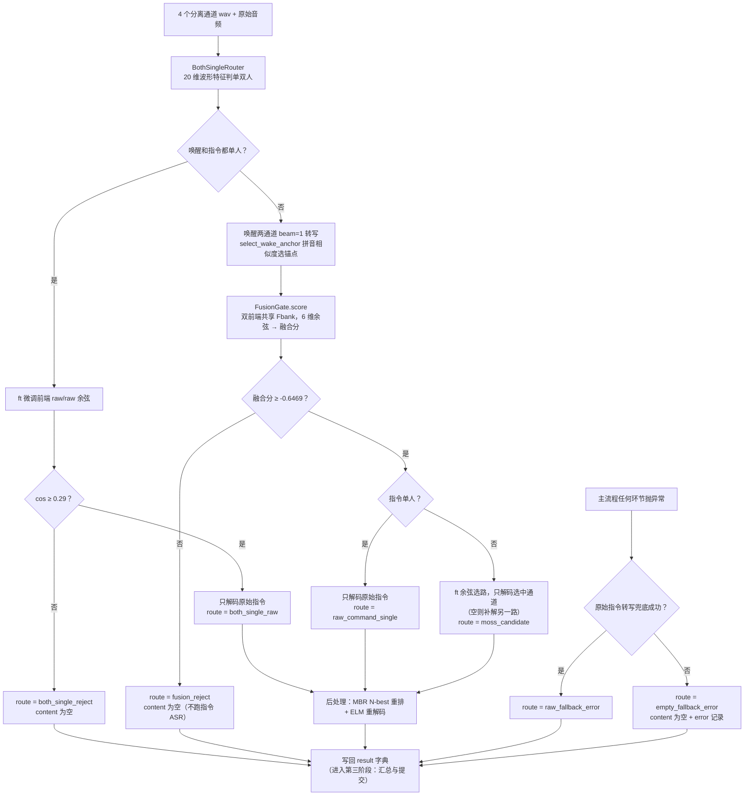

# 一条数据的流动全景（二）：识别与门控决策

> 本系列三篇文档回答同一个问题：**一条样本（一条数据）在系统里到底经历了什么**。
> 阅读顺序：`docs/代码库结构解读.md`（全局地图）→ 01（样本加载与分离）→ **本篇** → 03（汇总与提交）。
> 本篇涉及的代码：`src/szy/pipeline.py`（FusionGate、SzyRunner.process）、`src/szy/single_speaker.py`（BothSingleRouter）、`src/midea_qiji/moss_candidate.py`（select_wake_anchor）、`src/midea_qiji/phoneme.py`（拼音相似度）、`src/midea_qiji/gate.py`（ModelScopeEmbedder）、`src/midea_qiji/recognizers.py`（FireRed 后端）、`src/midea_qiji/firered_nbest.py`（MBR 重排）。
>
> **版本说明**：本篇描述 LSZ v4.5 现役流程（声学单双人路由 + 拼音锚点 + 延迟解码 + 选择后 N-best/ELM）。更早的"音色触发规则"版本已被取代，规则本体保留在 `moss_candidate.py` 供重放，演进细节见 `docs/OPTIMIZATION_SUMMARY.md`。

## 本文档讲什么

本篇讲样本旅程的第二站：**系统如何"看懂"音频并做出判决**。上一篇结束时，一条样本已经变成 4 个分离缓存 wav；本篇里系统先用**纯波形特征**判断"唤醒/指令是不是各只有一个人"（双单人走独立短路，几乎不花 ASR），常规分支再把唤醒通道送入 FireRed 转写、用**拼音相似度**选出"唤醒锚点"（哪一路分离音频最像目标人说的唤醒词），然后喂给融合门控做"这条指令里有没有目标人"的接受/拒绝判决；接受之后按单/双人路由各自只解码**一条**音频，最后对选中的文本做 N-best 重排与 ELM 重解码两件后处理。中途任何环节出错，都有两层异常兜底。

**数据在此阶段从「4 个分离 wav + 原始音频」变成「detail.json 的一行 result 字典」**（含 content、route、sv_score 等全部决策字段）。

## 1. 舞台：result 字典的默认值

`SzyRunner.process(sample)` 是逐样本处理的核心，每处理一个样本返回一个**可 JSON 序列化的字典**——它就是最终 `detail.json` 的一行。函数的第一件事不是干活，而是把字典的默认值全部填好（示例，节选）：

```python
{
    "id": "command/A001",
    "content": "",                    # 最终指令文本，先留空
    "label": "打开空调",
    "sample_type": "positive",        # label 非 None 即正样本
    "sv_score": "",                   # 门控分，先留空
    "accepted": False,
    "sv_accept_threshold": "-0.646900",
    "route": "fusion_reject",         # 默认路由 = 拒绝
    "selected_candidate": "",
    "switch_triggered": False,
    "command_source_empty": None,
    "wake_selected_source": None,
    "wake_raw_fallback": None,
    "wake_text_tie": None,
    "raw_confidence": None,
    "error": None,
    "both_single": False,             # 双单人判定（声学路由）
    "command_is_single": None,        # 指令是否为单人
    # ... 其余字段同源码
}
```

**为什么先填默认值再干活？** 因为后面的代码有多个提前返回的分支（拒绝分支、异常兜底分支），先填默认值能保证：无论从哪个分支离开，返回的字典**字段永远齐全**。这样 `detail.json` 每一行的结构完全一致，下游汇总、离线分析、前端展示都不需要处理"有的行缺字段"的情况。默认 `route` 是 `fusion_reject`、默认 `content` 是空——即"没被明确接受之前，先按拒绝处理"，这是安全一侧的默认。

## 2. 第一站 BothSingleRouter：纯波形的单双人预判

新流程的第一个判决**不花任何 ASR**：`szy.single_speaker.BothSingleRouter` 只吃 6 段波形（原始唤醒、原始指令、各自的两路分离），为每段音频提取 20 维声学统计量（分帧 RMS、强弱通道活跃比、弱通道能量占比、重构误差、包络相关性等），过一个外部训练的线性 logistic 分类器，输出"这段录音是单人"的概率。

为什么先做这件事？三个原因：

1. **便宜**：20 维统计量是纯 numpy 计算，成本远低于一次声纹 embedding 或 ASR 解码——"便宜特征先行短路贵流程"；
2. **信息足**：单人录音里分离器的弱通道几乎没有能量，这套统计量足以判单双人；
3. **决定路由**：判定结果直接决定后面"解码哪条音频"——单人指令的分离通道里没有额外信息，没必要解码。

```python
both_single = self.both_single_router.decide_both(
    raw_wake_wave, wake0_wave, wake1_wave,
    raw_command_wave, command0_wave, command1_wave,
)
```

20 维特征的设计要点是**通道交换不变性**：分离器的通道顺序是随机的（PIT 训练），所以所有特征都按"强通道/弱通道"排序后计算，而不是直接用 ms0/ms1——同一段音频无论分离器把目标放在哪一路，特征都一样。

## 3. 分支零：双单人短路（both_single_raw / both_single_reject）

当唤醒**和**指令都被判为单人时，走一条完全独立的短路：分离通道、拼音锚点、6 维门控全部跳过，直接用**微调 ERes2NetV2** 对两段原始音频算一次余弦：

```python
score = self.gate.finetuned_raw_cosine(raw_wake_wave, raw_command_wave)
accepted = score >= 0.29   # both_single_sft_threshold
```

两段音频都是单人时，"像不像同一个人"一次余弦就足以判断——6 维门控是为混合/分离场景设计的，这里没有混合问题。接受则 `route=both_single_raw`，只对**原始指令音频**做一次主解码（见 §6），然后直接进后处理（§8）；拒绝则 `route=both_single_reject`，content 留空返回。

注意短路分支不接受时**不跑任何指令 ASR**——拒绝的样本在整条链路里都遵守这个省钱原则。

## 4. 第二站 _transcribe_wake：唤醒通道的 beam=1 转写

常规分支里只有**唤醒两通道**在此刻转写（指令通道推迟到路由定了再说，见 §7）：

```python
wake0, wake1 = self._transcribe_wake([wake_paths[0], wake_paths[1]])
```

两个关键设计：

- **beam=1**：锚点选择要的是"稳定"而非"探索"，贪心解码结果最确定。生产上唤醒与命令**共享同一份 AED 权重**（省约 2.5 GB 显存，也消除双实例的数值抖动），靠 `temporary_beam_size(1)` 这个上下文管理器临时把束宽压回 1，退出自动恢复；
- **ELM 关闭**：所有"承载决策"的转写（唤醒锚点、各指令通道、原始指令）一律在 `temporary_elm_weight(0.0)` 下解码。原因：ELM 会扭曲 confidence 的量程（从 ~0.88 压到 ~0.60），而路由和后处理都依赖干净的置信度。ELM 只在最后对选定文本重解码一次（§8）。

转写结果经过统一口径：文本过 `normalize_transcript`（与官方评测一致的归一化），置信度非法/NaN/Inf 回退 1.0（"拿不到证据时先当它可信"，保守方向）。

### 4.1 ASR 缓存：同一段音频同一配置只解一次

所有转写都经过 `AsrCache`，缓存键是 **`<音频路径>|<解码配置标签>`**（如 `b3|elm0`、`b1|elm0`、`b3|elm0.15`）。为什么要带配置标签：同一段音频会在多种配置下被解码（主解码 ELM 关、ELM 重解码开），只按路径做键会把"别的配置解出的文本"错当本配置的结果。命中缓存直接返回，未命中才真实解码并写回。beam=3 主解码时模型顺手产出的 **N-best 候选也一并缓存**——后面的 MBR 重排（§8）直接复用，零额外推理。

## 5. 第三站 select_wake_anchor：拼音相似度选唤醒锚点

接下来要解决的问题：**两个分离出来的唤醒通道里，哪一个才是"目标人说的唤醒词"？** 门控需要一段"目标人的干净声纹参考"（锚点，anchor）去和指令音频比对，锚点越纯，判决越准。

`select_wake_anchor(wake_text, source0_text, source1_text)` 用唤醒词文字做判据，现役版本比较的是**拼音相似度**（`midea_qiji.phoneme.phoneme_similarity`）：

- 把文本转成拼音串再算编辑距离，相似度 = 负距离（0 = 读音完全一致）；
- 同音字不受罚："你好科慕" vs "你好科目"字不同但拼音相同 → 相似度 0。ASR 最常见的错误就是同音字，字符级编辑距离会冤枉一路好通道，拼音距离不会——这是全系统在 DatasetA 上最大的单项护城河（51 条锚点选择差异带来 81 字优势）；
- 唤醒词命中**别名表**时（"hi colmo" ↔ "嗨科慕"，拼音 `hicolmo` ↔ `haikemu`），自动展开所有变体取最高分。

裁决四分支：

- **两路都有字且分出胜负**：相似度高者当锚点，`wake_raw_fallback=False`；
- **两路都有字但打平**：读音一样像，无法可靠裁决 → **回退原始唤醒音频**（保守方向：选错一路的代价高于用混合音频）；
- **只有一路有字**：另一路是静音，同样回退原始唤醒（原始唤醒里肯定有目标人）；
- **两路都空**（退化情形）：回退原始唤醒，对比通道钉在 ms0，保证缓存重放确定。

### 5.1 raw 回退为何保留

"拿不准就回退原始唤醒"曾被挑战过：实验过"只要有一路非空就直接选它"（PR/CER 指标更好）。但竞赛官方计分公式是 **(1 − CER + RR) / 2**，RR（拒绝率）权重很高；在这个公式下，raw 回退版的总分更高（0.7977 vs 0.7939）。所以保留了回退行为——**指标口径决定设计取舍**，这是竞赛工程里反复出现的一课。

## 6. 第四站 FusionGate.score：融合门控

门控是整条链路的安全闸：判断**指令音频里有没有目标说话人**。没有 → 拒绝（content 留空）；有 → 才值得继续转写。现役实现是"双前端线性融合门控"，一次 `score` 调用拿到三样东西：是否接受、融合分、全部逐通道余弦（后两者被候选选择复用）。

它吃五段波形：锚点、原始唤醒、原始指令、指令 ms0、指令 ms1。

### 6.1 两个 ERes2NetV2 前端共享一次 Fbank

门控的声纹前端是 ERes2NetV2，装了**两个**：

- `pretrained`：官方预训练权重，给出通用、稳定的声纹证据；
- `finetuned`：同一结构，encoder 被 `model/artifacts/ep6_datasetA_best.pt`（分离域微调产物）覆盖，专门适应"分离出来的音频"这个域。

两个前端的**声学前端完全相同**（同一基座，只是 embedding_model 权重不同），所以 Fbank 特征提取只做一次（`prepare_waveforms`），两个前端各自前向 embedding_model（`extract_features`）——Fbank 计算量直接省一半，且不增加并发激活显存。

每个前端对五段波形各提取一个 **L2 归一化的 embedding**。归一化之后余弦相似度就等于点积——代码里的 `_cosine` 直接写 `np.dot`。

### 6.2 6 维余弦特征逐一解释

两个前端各算 3 个特征，拼成固定顺序的 6 维向量 `FUSION_FEATURE_KEYS = [pre_raw, ft_raw, pre_sep, ft_sep, ch_sim_pre, ch_sim_ft]`：

| 特征 | 含义 | 直觉 |
|---|---|---|
| `pre_raw` | 预训练前端下 cos(原始唤醒, 原始指令) | 原始混合里目标人信号有多强 |
| `ft_raw` | 微调前端下同一对余弦 | 适应分离域的视角再看原始混合 |
| `pre_sep` | 预训练前端下 max(cos(锚点, 指令ms0), cos(锚点, 指令ms1)) | 分离出的指令通道里目标人的最高浓度 |
| `ft_sep` | 微调前端下同上 | 微调视角下的分离收益 |
| `ch_sim_pre` | 预训练前端下 cos(指令ms0, 指令ms1) | 两个分离通道互相有多像（通道/内容一致性线索） |
| `ch_sim_ft` | 微调前端下同上 | 同上，微调视角 |

前四个是"原始 vs 分离"的证据对比：如果分离真的把目标人提炼出来了，`*_sep` 应该明显高于 `*_raw`。后两个衡量分离结果自身的一致性。

一个细节：当指令被判为**单人**（`command_source_empty=True` 传入）时，`*_sep` 的候选里会**追加 cos(锚点, 原始指令)** 再取最大——单人录音的分离通道可能近乎静音，原始指令才是有效候选，避免空通道污染门控输入。

### 6.3 z-score 标准化 + 线性融合 + 阈值 -0.6469

```python
x = (features - mean) / std          # mean/std 来自 model/artifacts/gate_fusion.json
score = x @ weight + bias            # weight/bias 同源
accepted = score >= -0.6469          # fusion_threshold
```

`gate_fusion.json` 在 dasynth 验证集上离线标定（零 DatasetA 调参）。加载时有硬校验：文件里的 `features` 顺序必须与代码里的 `FUSION_FEATURE_KEYS` 逐项一致，否则直接报错——**防止权重和特征悄悄错位**（错位后模型照样能跑、分数照样有，但全部判决都是错的，且极难排查）。

## 7. 分支一/二：拒绝、单人指令、双人指令的延迟解码

**拒绝（fusion_reject）**：融合分低于阈值时写回门控信息、提前返回，**不跑任何指令 ASR**——这是全链路最大的计算量节省点。

**单人指令（raw_command_single）**：`command_is_single=True`（声学判定，见 §2）时，只对**原始指令音频**做一次主解码（beam=3，ELM 关）。单人录音的分离通道没有额外信息，不解码它们——省两次 ASR。

**双人指令（moss_candidate）**：恒切分离通道，但同样只解码**一条**：

```python
preferred = 0 if ft_cos_cmd0 >= ft_cos_cmd1 else 1   # 复用门控已算的余弦，零成本
selected_result = self._transcribe([command_paths[preferred]])[0]
if not selected_result["text"]:                       # 首选转写为空才补解另一路
    selected_result = self._transcribe([command_paths[1 - preferred]])[0]
```

ft 余弦与门控同一打分原理、复用同一批 embedding；**原始指令始终不解码**——双人混合的 raw 转写没有参考价值，省下第三次 ASR。"先选路再解码"相对旧版"全解码再选路"省一半以上的指令 ASR，且缓存机制保证重跑时这些解码全部免费。

## 8. 后处理两件套：N-best 重排 + ELM 重解码

路由选定的那一条文本，还要经过两个后处理才成为最终 content。**它们只作用于选定通道、只跑一次，不可能反向影响门控或路由**——这是 Phase 2 的核心不变量（旧版 ELM 融在主解码里会污染置信度量程，让路由规则退化，详见 `docs/OPTIMIZATION_SUMMARY.md` 附录）。

### 8.1 保守 MBR N-best 重排

beam=3 主解码时模型本来就算出了多条候选（已随缓存存下），MBR（最小贝叶斯风险）重排序选"与其他候选平均差异最小"的那条——候选集合的"中位数"，期望错误最少。"保守"体现在两道闸**同时过**才允许换掉 top-1：置信度增益 ≥ 0.03 且 MBR 风险下降 ≥ 0.05。宁可不换，不可换错。

### 8.2 ELM 重解码

外部语言模型（ELM）熟悉智能家居领域词汇，能纠正"调到/掉到"这类同音错误——这是全系统最大的单项提分来源（+0.0126）。它在 `temporary_elm_weight(0.15)` 下对选定通道**重解码一次**；空文本不重解（语言模型不许凭空造文本）。

后处理字段（`baseline_content` / `nbest_applied` / `nbest_reason` / `elm_applied` / `elm_content`）全部写进 detail.json，事后可审计"最终文本是怎么来的"。

## 9. 全部 route 分支一览表

| route | 触发条件 | content 来源 | 含义 |
|---|---|---|---|
| `both_single_reject` | 双单人但余弦 < 0.29 | 空字符串 | 两段单人音频不是同一人 |
| `both_single_raw` | 双单人且余弦 ≥ 0.29 | 原始指令转写（+后处理） | 双单人短路 |
| `fusion_reject` | 融合分 < -0.6469 | 空字符串 | 门控判定指令里没有目标人 |
| `raw_command_single` | 门控接受 + 指令单人 | 原始指令转写（+后处理） | 单人指令直接用混合转写 |
| `moss_candidate` | 门控接受 + 指令双人 | ft 余弦选中通道的转写（+后处理） | 双人指令恒切分离通道 |
| `raw_fallback_error` | 主流程任何环节抛异常，raw 兜底成功 | `asr.transcribe_many([command_audio])` | 异常降级，但保住了内容 |
| `empty_fallback_error` | 异常且 raw 兜底也失败 | 空字符串 | 最坏情况，样本置空但不会消失 |

## 10. 两层异常兜底：为什么是生产关键

`process` 的主流程整个包在 `try/except` 里，异常时走两层兜底：

1. **第一层**：把异常类型和消息写进 `error` 字段，然后尝试用 `asr.transcribe_many` 直接转写原始指令音频。成功 → `route = "raw_fallback_error"`，样本保住内容；
2. **第二层**：连原始转写都失败，把第二次异常追加进 `error`，`route = "empty_fallback_error"`，content 保持空。

为什么这在生产环境是刚需，而不是可选的防御？

- **一条坏样本不能拖垮整批。** 真实数据里什么都有：损坏的音频、极端长度的样本、偶发的显存不足。没有兜底时，一条样本抛异常就会让整次运行中断，几百条已完成的样本白跑；
- **样本永远不消失。** 无论多惨，每条样本都会在 detail.json 里留下一行、带着自己的 route 和 error。指标统计永远"账实相符"，不会悄悄少一条；
- **可诊断。** `error` 字段保留完整的异常类型和消息（两层都记），赛后复盘时按 `separation_errors` 一筛就能定位所有出问题的样本。

## 11. 决策流程图



## 12. 小结

本阶段完成的形态转换：

```
4 个分离 wav（+ 原始唤醒/指令音频）
  → 单双人判定（20 维波形特征，零 ASR）
  → [双单人短路：一次余弦判同人]
  → 唤醒通道 beam=1 转写 → 拼音锚点（打平/单路回退原始唤醒）
  → 融合分（双前端共享 Fbank，6 维余弦，阈值 -0.6469）
  → 单/双人路由：各自只解码一条音频（缓存复用）
  → 后处理：MBR N-best 重排 + ELM 重解码（仅选定通道）
  → result 字典一行（route 七选一，异常两层兜底）
```

这一行 result 字典会被批量落盘进 checkpoint、汇总成指标、写出提交物与报告——那是下一篇的故事。

**上一站**：`docs/一条数据的流动全景-01-样本加载与分离前端.md`
**下一站**：`docs/一条数据的流动全景-03-汇总与提交产出.md`
