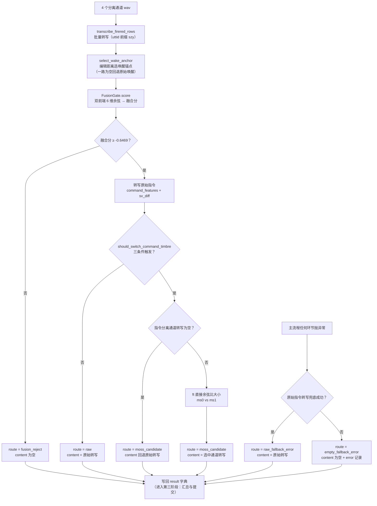

# 一条数据的流动全景（二）：识别与门控决策

> 本系列三篇文档回答同一个问题：**一条样本（一条数据）在系统里到底经历了什么**。
> 阅读顺序：`docs/代码库结构解读.md`（全局地图）→ 01（样本加载与分离）→ **本篇** → 03（汇总与提交）。
> 本篇涉及的代码：`src/szy/pipeline.py`（FusionGate、SzyRunner.process）、`src/szy/helpers.py`（transcribe_firered_rows、command_features）、`src/midea_qiji/moss_candidate.py`（select_wake_anchor、should_switch_command_timbre）、`src/midea_qiji/gate.py`（ModelScopeEmbedder）、`src/midea_qiji/recognizers.py`（FireRed 后端）。

## 本文档讲什么

本篇讲样本旅程的第二站：**系统如何"看懂"音频并做出判决**。上一篇结束时，一条样本已经变成 4 个分离缓存 wav；本篇里它们被批量送入 FireRed ASR 转写，转写结果先决定"唤醒锚点"（哪一路分离音频最像目标人说的唤醒词），再喂给融合门控做"这条指令里有没有目标人"的接受/拒绝判决；接受之后，还要经过一道音色触发规则和一次候选选择，才能决定最终的指令文本。中途任何环节出错，都有两层异常兜底。

**数据在此阶段从「4 个分离 wav + 原始音频」变成「detail.json 的一行 result 字典」**（含 content、route、sv_score 等全部决策字段）。

## 1. 舞台：result 字典的默认值

`SzyRunner.process(sample)` 是逐样本处理的核心，每处理一个样本返回一个**可 JSON 序列化的字典**——它就是最终 `detail.json` 的一行。函数的第一件事不是干活，而是把字典的默认值全部填好（示例，节选）：

```python
{
    "id": "command/A001",
    "content": "",                    # 最终指令文本，先留空
    "label": "打开空调",
    "sample_type": "positive",        # label 非 None 即正样本
    "sv_score": "",                   # 融合分，先留空
    "accepted": False,
    "sv_accept_threshold": "-0.646900",
    "route": "fusion_reject",         # 默认路由 = 拒绝
    "selected_candidate": "",
    "switch_triggered": False,
    "command_source_empty": None,
    "wake_selected_source": None,
    "wake_raw_fallback": None,
    "wake_text_tie": None,
    "raw_confidence": None,
    "chars_per_sec": None,
    "command_keyword_score": None,
    "error": None,
}
```

**为什么先填默认值再干活？** 因为后面的代码有多个提前返回的分支（拒绝分支、异常兜底分支），先填默认值能保证：无论从哪个分支离开，返回的字典**字段永远齐全**。这样 `detail.json` 每一行的结构完全一致，下游汇总、离线分析、前端展示都不需要处理"有的行缺字段"的情况。默认 `route` 是 `fusion_reject`、默认 `content` 是空——即"没被明确接受之前，先按拒绝处理"，这是安全一侧的默认。

## 2. 第一站 transcribe_firered_rows：4 个通道批量转写

`transcribe_firered_rows(asr, paths, prefix)` 定义在 `szy.helpers`，是管线里**所有** FireRed 转写的统一入口。本阶段第一次调用它时，传入的是上一篇产出的 4 个分离通道：

```python
wake0, wake1, command0, command1 = transcribe_firered_rows(
    self.asr,
    [wake_paths[0], wake_paths[1], command_paths[0], command_paths[1]],  # 唤醒ms0/ms1 + 指令ms0/ms1
    "szy",
)
```

### 2.1 uttid 前缀：把结果对回输入

FireRed 的底层接口要求每条音频带一个 utterance id（uttid）。这里用 `f"{prefix}_{index}"` 生成：`szy_0`、`szy_1`、`szy_2`、`szy_3`。模型返回的每一行都带 `uttid` 字段，代码把它建成 `{uttid: row}` 的映射，再按 `szy_0` 到 `szy_3` 的顺序逐一对回输入路径——**顺序由 uttid 保证，而不是依赖返回列表的顺序**（后端实现细节变化时不会悄悄错位）。返回行数对不上时直接抛 `RuntimeError`。

转写全程包在 `suppress_model_output()` 里：把 stdout/stderr 重定向到空设备，压掉模型加载和推理时打印的噪音，让进度条和日志保持干净。

### 2.2 置信度解析与 1.0 回退

FireRed 返回的行里有 `confidence` 字段，但它的格式并不总是可靠的。`asr_confidence` 的规则是：能转成有限浮点数就原样返回；转不了（缺失、是字符串垃圾）、或者转出来是 NaN/Inf，就**回退到 1.0**。

**为什么回退到 1.0 而不是 0？** 看置信度在后面的用途：它是音色触发规则的输入，置信度低是"转写不可信、该考虑切换"的信号。回退到 1.0 等于说"拿不到证据时，先当它可信"——这样异常情况只会让规则**保守地不切换**（用原始转写），而不是激进地乱切。回退 0 会把所有缺置信度的样本都误判成"低置信度"，触发一堆不该发生的切换。

### 2.3 文本归一化

转写出来的文本要经过 `midea_qiji.text.normalize_transcript` 归一化：阿拉伯数字转中文（25 → 二十五，105 → 一百零五）、百分号展开（25% → 百分之二十五）、去掉全部标点和空白、转小写。**这是与官方评测口径一致的归一化**，后面算 CER 时参考文本也走同一函数——两边口径不同的话，编辑距离就没有意义。这个函数语义被冻结，任何改动都会破坏 CER/PR/RR 的复现。

最终，4 个通道变成 4 个"文本 + 置信度"的字典（示例）：

```python
[
    {"text": "你好美的", "confidence": 0.912},   # 唤醒 ms0
    {"text": "",        "confidence": 0.834},   # 唤醒 ms1（分离后是静音）
    {"text": "打开空调", "confidence": 0.876},   # 指令 ms0
    {"text": "打开音响", "confidence": 0.421},   # 指令 ms1
]
```

## 3. 第二站 select_wake_anchor：唤醒锚点选择

接下来要解决的问题：**两个分离出来的唤醒通道里，哪一个才是"目标人说的唤醒词"？** 门控需要一段"目标人的干净声纹参考"（锚点，anchor）去和指令音频比对，锚点越纯，判决越准。

`select_wake_anchor(wake_text, source0_text, source1_text)` 用唤醒词文字做判据——转写文本和标准唤醒词**越接近的那一路，越可能是目标人**：

- **两路都有字**：算各自与唤醒词（归一化后）的**字符级编辑距离**（插入/删除/替换的最小步数，不除以长度——与历史行为逐字一致），距离小的胜出；打平选 ms0。此时用胜出通道当锚点，`wake_raw_fallback=False`；
- **只有一路有字**：说明另一路分离出来是静音（对应示例里 `wake_ms1` 转写为空）。此时**回退到原始唤醒音频**当锚点（`wake_raw_fallback=True`），理由：分离只剩一路时没有"两路对比"的信息量了，而原始唤醒音频里肯定有目标人（唤醒词就是目标人念的），用原始音频更稳；
- **两路都空**（分离整体失败的退化情形）：同样回退原始唤醒，且把对比通道固定钉在 ms0，保证缓存重放时行为确定。

选好之后，锚点音频路径是这样决定的：

```python
anchor_path = sample.wake_audio if gate_anchor.raw_wake_fallback else wake_paths[gate_anchor.selected_source]
```

### 3.1 raw 回退为何保留

"一路为空就回退原始唤醒"这个行为曾经被挑战过：实验过"只要有一路非空就直接选它"（PR/CER 指标更好）。但竞赛官方计分公式是 **(1 − CER + RR) / 2**，其中 RR（拒绝率）权重很高；在这个公式下，raw 回退版的总分更高（0.7977 vs 0.7939）。所以保留了回退行为——**指标口径决定设计取舍**，这是竞赛工程里反复出现的一课。

## 4. 第三站 FusionGate.score：融合门控

门控是整条链路的安全闸：判断**指令音频里有没有目标说话人**。没有 → 拒绝（content 留空）；有 → 才值得继续转写。现役实现是"双前端线性融合门控"，一次 `score` 调用拿到三样东西：是否接受、融合分、全部逐通道余弦（后两者还要被候选选择复用）。

它吃五段波形：锚点、原始唤醒、原始指令、指令 ms0、指令 ms1。所有波形都用 `midea_qiji.audio.read_wav` 读取——这就是上一篇把分离产物写成"16k 单声道 PCM16"的原因：两个阶段的读取口径必须一致。

### 4.1 两个 ERes2NetV2 前端

门控的声纹前端是 ERes2NetV2（ModelScope 上的 `iic/speech_eres2netv2_sv_zh-cn_16k-common`），而且**装了两个**：

- `pretrained`：官方预训练权重，给出通用、稳定的声纹证据；
- `finetuned`：同一个模型结构，但 encoder 被 `model/artifacts/ep6_datasetA_best.pt`（分离域微调产物）覆盖。分离音频不是自然语音，官方权重对它的判断会偏，微调权重专门适应了"分离出来的音频"这个域。

每个前端对五段波形各提取一个 **L2 归一化的 embedding**（`ModelScopeEmbedder.extract_waveforms`，内部把波形预处理成特征、批量前向、再归一化到单位长度）。归一化之后，两个 embedding 的**余弦相似度就等于点积**——所以代码里的 `_cosine` 直接写 `np.dot`。

### 4.2 6 维余弦特征逐一解释

两个前端各算 3 个特征，拼成固定顺序的 6 维向量 `FUSION_FEATURE_KEYS = [pre_raw, ft_raw, pre_sep, ft_sep, ch_sim_pre, ch_sim_ft]`：

| 特征 | 含义 | 直觉 |
|---|---|---|
| `pre_raw` | 预训练前端下 cos(原始唤醒, 原始指令) | 原始混合里目标人信号有多强 |
| `ft_raw` | 微调前端下同一对余弦 | 适应分离域的视角再看原始混合 |
| `pre_sep` | 预训练前端下 max(cos(锚点, 指令ms0), cos(锚点, 指令ms1)) | 分离出的指令通道里目标人的最高浓度 |
| `ft_sep` | 微调前端下同上 | 微调视角下的分离收益 |
| `ch_sim_pre` | 预训练前端下 cos(指令ms0, 指令ms1) | 两个分离通道互相有多像（通道/内容一致性线索） |
| `ch_sim_ft` | 微调前端下同上 | 同上，微调视角 |

前四个是"原始 vs 分离"的证据对比：如果分离真的把目标人提炼出来了，`*_sep` 应该明显高于 `*_raw`。后两个衡量分离结果自身的一致性。

一个细节：当分离通道转写为空（`command_source_empty=True`，即 command0/command1 任一为空）时，`pre_sep`/`ft_sep` 的候选里会**追加 cos(锚点, 原始指令)** 再取最大——避免空通道的糟糕余弦把门控输入污染掉。

### 4.3 z-score 标准化 + 线性融合 + 阈值 -0.6469

6 维特征先做 z-score 标准化再线性融合：

```python
x = (features - mean) / std          # mean/std 来自 model/artifacts/gate_fusion.json
score = x @ weight + bias            # weight/bias 同源
accepted = score >= -0.6469          # fusion_threshold
```

`model/artifacts/gate_fusion.json` 里存着 `features`、`mean`、`std`、`weight`、`bias` 五样东西，是离线在 dasynth 验证集上标定出来的。加载时有个硬校验：文件里的 `features` 顺序必须与代码里的 `FUSION_FEATURE_KEYS` 逐项一致，否则直接报错——**防止权重和特征悄悄错位**（错位后模型照样能跑、分数照样有，但全部判决都是错的，且极难排查）。

融合分是线性组合的值，不是概率，所以阈值是负数（-0.6469）——它在 dasynth 验证集上被标定为"接受/拒绝"的最佳切点，负数本身没有特殊含义，只是这个分数空间的量纲使然。判决是"分数 ≥ 阈值则接受"，没有任何捷径：**阈值只信数据标定，不信直觉**。

## 5. 分支一：拒绝（fusion_reject）

融合分低于 -0.6469 时，函数把门控阶段收集的信息写进字典（`sv_score`、`gate_features` 六项、`wake_selected_source`、`wake_raw_fallback`、`command_source_empty`），记下耗时，**提前返回**。字典保持默认的 `route=fusion_reject`、`content=""`。

拒绝对两类样本的意义完全不同：对负样本（指令里本来就没有目标人），拒绝是**正确行为**，content 为空正好贡献 RR；对正样本，拒绝是漏检，content 为空会在 CER 上付出代价——这套"用一个判决同时服务两类样本"的设计，正是竞赛指标（CER 和 RR）把两者绑在一起的原因。

## 6. 分支二：接受 → raw 指令转写 → 音色触发三条件

门控接受之后，流程继续往下走，目标是产出**最可靠的指令文本**。

### 6.1 raw 指令转写

第一步是给**原始指令音频**（不分离的那段混合）单独做一次转写：`transcribe_firered_rows(self.asr, [sample.command_audio], "szy")[0]`。这个"raw 转写"是候选里的常驻选手——转写在混合上做，没有分离带来的失真，但会混入干扰人的话。

### 6.2 command_features：字速 + 指令关键词

接着对 raw 转写文本算两个特征（`szy.helpers.command_features`）：

- **字速** `chars_per_sec` = 归一化文本字数 / 音频时长（秒，`duration_seconds` 用 `sf.info` 只读文件头算时长，不解码整段音频；时长下限 0.1 秒防止除零）。字速过高往往意味着 ASR 把重叠的多人语音"连读"成了一串胡话；
- **指令关键词命中数** `command_keyword_score` = 转写里命中 `CMD_KW` 正则的次数。这个正则是一张智能家居词表：打开、关闭、关掉、调到、空调、灯光、窗帘、音乐、电视、风扇、加湿、净化、扫地、温度、音量、模式、洗衣、烘干、冰箱、热水、新风、播放、暂停、继续、小声、大声、亮度、风速、洗澡、叫醒、闹钟、出门、回家、晚安。

关键词是"这串字像不像一条指令"的最直接证据——竞赛的指令都是控制家电的话，不像指令的转写大概率转错了人。

### 6.3 sv_diff 的物理含义

```python
sv_diff = max(ft_cos_cmd0, ft_cos_cmd1) - ft_rawcmd
```

即（微调前端下）**锚点与两个分离指令通道的较大余弦** 减去 **锚点与原始混合指令的余弦**。它直接测量一件事：**分离有没有让目标嗓音比原始混合里更突出**。`sv_diff > 0` 说明分离通道里目标人的浓度更高——这正是"切换到分离转写"这件事能成立的物理机制。三个余弦全部复用门控阶段已经算好的数值（`ft_cos_cmd0`、`ft_cos_cmd1`、`ft_rawcmd` 在 `score` 里顺带算好并存下），**不增加任何额外的 embedding 计算**。

### 6.4 should_switch_command_timbre：三条件

是否切换到分离通道转写，由 `midea_qiji.moss_candidate.should_switch_command_timbre` 裁决，输入三个量：置信度、关键词命中数、sv_diff。规则是：

- 若 **confidence ≤ 0.70**（低置信区间）：`关键词 ≥ 0.5` 或 `sv_diff > 0.05` 或 `confidence ≤ 0.57` 任一满足即切换；
- 否则（高置信区间）：`sv_diff > 0.05` **且** `关键词 < 0.5` 才切换。

三个条件的分工值得拆开看：

1. **confidence ≤ 0.57 是"必坏线"**：ASR 自己都没信心，转写大概率是垃圾，无论其他证据如何都切；
2. **sv_diff > 0.05 是主判决**：声纹证据说"分离通道里目标人更突出"，这是切换的核心依据。0.05 这个阈值有个平坦盆地（[0.02, 0.08] 区间内结果都稳定），说明它不是靠运气卡出来的临界点；
3. **关键词是"高置信否决"**：高置信度 + 像指令 + 声纹却说分离更好——这组合意味着 ASR 很自信地把**干扰人的话**当成了指令（转错了人），此时关键词条件反转（要求 < 0.5 才切），专门拦下这种情况。

字速 `chars_per_sec` 是历史语速规则的遗留特征，现役音色规则不再使用它，但数值仍被写进 detail.json，供触发阈值的离线重扫。

切换与否，先写下一批字段：`route = "moss_candidate"`（切）或 `"raw"`（不切），`content` 暂填 raw 转写，`selected_candidate` 暂填 `"orig"`，并记下 `raw_confidence`、`chars_per_sec`、`command_keyword_score`、`sv_diff`、`raw_text`、两个指令通道的转写和 `ft_cos_ms0/ms1`（后者供离线重扫复用）。不切换时直接返回，`selection_reason = "timbre_switch_rule_not_triggered"`。

## 7. 候选选择：ft 直接余弦 vs 空通道回退 orig

切换被触发后，最后一问：**用哪个通道的转写当最终答案？**

- 若 `command_source_empty`（指令分离通道有转写为空的）：分离被判定为失败，`selected_candidate` 保持 `"orig"`（raw 转写），`selection_reason = "command_source_empty"`；
- 否则，比较门控阶段已算好的两个余弦：**ft 余弦更大的通道胜出**（`ms0` 若 `ft_cos_cmd0 >= ft_cos_cmd1`，否则 `ms1`），`selection_reason = "ft_direct_cosine"`。选通道用声纹证据，与门控是同一打分原理，且**复用同一批 embedding**——这就是为什么候选选择零额外成本。

胜出后 `content` 被替换为选中通道的转写文本，并补齐 `wake_contrast_source`、`wake_text_tie`、两个唤醒通道和两个指令通道的转写文本。

## 8. 全部 route 分支一览表

一条样本跑完，`route` 字段恰好是五种取值之一：

| route | 触发条件 | content 来源 | 含义 |
|---|---|---|---|
| `fusion_reject` | 融合分 < -0.6469 | 空字符串 | 门控判定指令里没有目标人，拒绝 |
| `raw` | 门控接受，但音色三条件未触发 | 原始指令音频的 FireRed 转写 | 混合转写足够可信，不需要分离候选 |
| `moss_candidate` | 门控接受 + 音色触发 | ft 余弦较大的 ms0/ms1 通道转写；通道为空时回退 raw 转写 | 用分离通道的转写替换混合转写 |
| `raw_fallback_error` | 主流程任何环节抛异常，raw 兜底成功 | `asr.transcribe_many([command_audio])` 的转写 | 异常降级，但保住了内容 |
| `empty_fallback_error` | 异常且 raw 兜底也失败 | 空字符串 | 最坏情况，样本置空但不会消失 |

## 9. 两层异常兜底：为什么是生产关键

`process` 的主流程整个包在 `try/except` 里，异常时走两层兜底：

1. **第一层**：把异常类型和消息写进 `error` 字段，然后尝试用 `asr.transcribe_many` 直接转写原始指令音频。成功 → `route = "raw_fallback_error"`，`selected_candidate = "orig"`，样本保住内容；
2. **第二层**：连原始转写都失败，把第二次异常追加进 `error`，`route = "empty_fallback_error"`，content 保持空。

为什么这在生产环境是刚需，而不是可选的防御？

- **一条坏样本不能拖垮整批。** 真实数据里什么都有：损坏的音频、极端长度的样本、偶发的显存不足。没有兜底时，一条样本抛异常就会让整次运行中断，几百条已完成的样本白跑；
- **样本永远不消失。** 无论多惨，每条样本都会在 detail.json 里留下一行、带着自己的 route 和 error。正样本兜底失败 → content 为空 → CER 上诚实地记一次错误；负样本兜底失败 → content 为空 → 恰好是正确拒绝。指标统计永远"账实相符"，不会悄悄少一条；
- **可诊断。** `error` 字段保留完整的异常类型和消息（两层都记），赛后复盘时按 `separation_errors` 一筛就能定位所有出问题的样本。

## 10. 决策流程图



## 11. 小结

本阶段完成的形态转换：

```
4 个分离 wav（+ 原始唤醒/指令音频）
  → 4 行转写 {text, confidence}（归一化文本 + 1.0 回退置信度）
  → 唤醒锚点（编辑距离选源 / raw 回退）
  → 融合分（双前端 6 维余弦，阈值 -0.6469）
  → 音色三条件（conf / sv_diff / 关键词）
  → 候选选择（ft 余弦 ms0/ms1，空通道回退 orig）
  → result 字典一行（route 五选一，异常两层兜底）
```

这一行 result 字典会被逐条落盘进 checkpoint、汇总成指标、写出提交物——那是下一篇的故事。

**上一站**：`docs/一条数据的流动全景-01-样本加载与分离前端.md`
**下一站**：`docs/一条数据的流动全景-03-汇总与提交产出.md`
