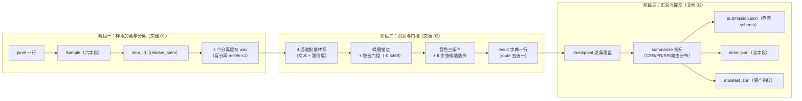

# 一条数据的流动全景（三）：汇总与提交产出

> 本系列三篇文档回答同一个问题：**一条样本（一条数据）在系统里到底经历了什么**。
> 阅读顺序：`docs/代码库结构解读.md`（全局地图）→ 01（样本加载与分离）→ 02（识别与门控决策）→ **本篇**。
> 本篇涉及的代码：`src/szy/cli.py`、`src/szy/reporting.py`、`src/szy/helpers.py`（sha256_file）、`scripts/run.sh`。

## 本文档讲什么

本篇讲样本旅程的第三站，也是终点站：**一条条样本的结果如何变成可提交、可复盘的产物**。包括：断点续跑机制（为什么长任务不怕中断）、指标汇总的口径（CER/PR/RR 到底怎么算）、竞赛提交文件与全字段明细的 schema、资产指纹清单的意义，以及 `outputs/` 目录最终的完整产物清单。

**数据在此阶段从「逐样本 result 字典的列表」变成「outputs/ 下的四份 JSON + 分离缓存」**（submission.json、detail.json、checkpoint.json、manifest.json、szy_cache/）。

## 1. 入口回顾：python -m szy.cli 与 scripts/run.sh

先回顾一下总入口在做什么。`bash scripts/run.sh` 设置好环境变量后调用 `python -m szy.cli`：

```bash
CUDA_VISIBLE_DEVICES=1 \
PYTHONPATH=src:model/runtime/vendor \
MODELSCOPE_CACHE=model/workspace/midea/models/modelscope \
HF_HUB_OFFLINE=1 \
python -u -m szy.cli \
  --data-root dataset/dataset_test/datasetA/datasetA \
  --jsonl dataset/.../pos.jsonl dataset/.../neg.jsonl \
  --config configs/pipeline_firered.json \
  --output outputs/submission.json \
  --final-output outputs/detail.json \
  --checkpoint-output outputs/checkpoint.json \
  --manifest-output outputs/manifest.json
```

几个环境变量的意义：`PYTHONPATH` 让 Python 能找到 `src/szy` 包和 vendor 里的 FireRed 运行依赖；`MODELSCOPE_CACHE` 指向本地模型仓库，供声纹模型的本地解析；`HF_HUB_OFFLINE=1` 禁止运行时联网拉模型——**竞赛环境必须离线可复现**，任何隐式联网下载都是事故隐患。末尾的 `"$@"` 允许追加参数（如 `--limit 10` 只跑十条调试、`--resume` 续跑）。

cli 的主体流程只有三步：读配置和样本清单 → 循环逐样本调用 `runner.process()`（第一篇和第二篇讲的内容）→ 汇总并写出四份产物。本篇讲的就是第三步，以及夹在中间的断点续跑。

## 2. checkpoint 断点续跑：每条样本都落盘

全量样本的处理循环是这个形状：

```python
for sample in tqdm(samples, desc="szy", unit="utt"):
    result = runner.process(sample)      # 第二篇的全部决策逻辑
    results.append(result)
    # 每条样本处理完，立刻把 checkpoint 整份重写一遍
    checkpoint_path.write_text(json.dumps(
        {"version": "szy", "duration": elapsed, "results": results},
        ensure_ascii=False, indent=2), encoding="utf-8")
```

checkpoint（默认 `outputs/checkpoint.json`）就是一个 `{"version": "szy", "duration": 已耗时秒数, "results": [已完成的全部 result 字典]}` 的 JSON。**每处理完一条样本就整份重写一次**——看起来"浪费"，却是最稳的做法：

- **随时可中断。** 全量跑完可能要好几个小时，GPU 机器可能被抢占、断电、超时。因为每条样本都即时落盘，中断时最多损失"正在处理的这一条"，其余全部安全；
- **写坏也不怕。** 就算某次写入恰好被杀死在文件写一半的状态，也只是丢了那一次的增量，前面的进度还在（checkpoint 是整份快照）；
- **配合 `--resume` 续跑。** 重跑时带上 `--resume`，cli 会读回 checkpoint：`results` 直接接上、`duration` 从上次的已耗时继续累加，然后**按 id 去重**——把 `submission_id` 已经出现在 checkpoint 里的样本从待处理列表里剔除，只跑没跑过的。加上第一篇讲的分离缓存，"改一个阈值重跑全量"时，分离和已完成的样本全部跳过，成本几乎只剩新增样本的处理。

去重的 key 是 `submission_id`（relative_stem 口径的 item_id），与提交文件的 id、缓存文件的命名三处一致——**同一个编号贯穿全程**，这是整套断点/缓存/提交体系能咬合的前提。

`batch_writes` 配置项（现役为 1）控制的就是这个写出的粒度：每批多少条样本后强制写出一次 checkpoint。当前按 1 条一批，即每条都写。

## 3. summarize：指标口径

所有样本跑完后，`szy.reporting.summarize(results, duration)` 把几百行的 result 列表压成一份指标字典。理解它的关键是先弄清**正负样本怎么分**：

- **正样本**：`label` 非 `None` 且非空字符串——即 jsonl 里带"识别文本"标注的行；
- **负样本**：其余全部（label 缺失或为空串）。

### 3.1 CER：编辑距离 / 参考字数

CER（字符错误率）只在正样本上算：对每条正样本，把 `content`（系统输出）和 `label`（标准答案）**都先过 `normalize_transcript` 归一化**（与第二篇转写文本用的同一个函数——口径一致才有意义），再算字符级编辑距离。汇总口径是：

```
final_cer = 全部正样本的编辑距离之和 / 全部正样本的参考字数之和
```

注意它**不是**"每条样本 CER 的平均"，而是分子分母各自求和再除——长样本的每个字都被平等计数，不会被短样本稀释或放大。

### 3.2 PR：正样本非空率

```
final_pr = 正样本中 content 非空的条数 / 正样本总数
```

PR 衡量"该转出来的转出来了没有"。正样本被门控误拒或两层兜底失败时 content 为空，就会拉低 PR。

### 3.3 RR：负样本拒绝率

```
final_rr = 负样本中 content 为空的条数 / 负样本总数
```

RR 衡量"该拒的拒掉了没有"。负样本的 content 为空意味着系统没有输出任何东西——这正是负样本该有的表现。第一篇和第二篇反复提到的"拒绝分支让负样本贡献 RR、让正样本付出 CER 代价"，在这里落到纸面上。

### 3.4 其余统计项

| 字段 | 含义 |
|---|---|
| `sample_count` / `positive_count` / `negative_count` | 样本总数 / 正样本数 / 负样本数 |
| `positive_nonempty` / `negative_rejects` | PR、RR 的分子 |
| `errors` / `characters` | CER 的分子（总编辑距离）/ 分母（总参考字数） |
| `duration` | 总耗时（秒），续跑时包含上次的已耗时 |
| `routes` | 路由分布计数（第二篇的五种 route 各出现多少次） |
| `switches` | `switch_triggered` 为真的样本数（切换发生了几次） |
| `separation_errors` | 带 `error` 字段的样本数（两层兜底触发了几次） |

`routes` 和 `switches` 是赛后的"体检报告"：如果某次改动后 `raw_fallback_error` 突然暴涨，说明改动引入了异常；`switches` 的分布变化能反映触发规则是否失准。

## 4. write_outputs：submission.json 与 detail.json

汇总完成后，`write_outputs(results, summary, output, detail)` 写出两份文件。

### 4.1 submission.json：竞赛提交 schema

提交文件的结构严格遵循竞赛格式（示例）：

```json
{
  "result": {
    "results": [
      {"id": "command/A001", "content": "打开空调", "label": "打开空调", "cer": 0.0},
      {"id": "command/A002", "content": "打开音",   "label": "打开音响", "cer": 0.25},
      {"id": "command/B001", "content": "",         "label": null,      "cer": null}
    ],
    "avg_cer": 0.1234,
    "avg_rr": 0.95,
    "duration": 1845234.567
  }
}
```

要点：

- `results` 每条只有四个字段：`id`（relative_stem 口径）、`content`（系统输出）、`label`（标注原样）、`cer`（这一条的字符错误率）；
- **逐条 cer 的口径**：正样本 = 归一化后编辑距离 / 归一化参考长度（参考为空串时，输出非空记 1.0、为空记 0.0）；负样本 = `null`（负样本没有标准答案，不存在错误率）；
- `avg_cer` 和 `avg_rr` 直接取 summary 里的 `final_cer`/`final_rr`；
- **`duration` 的单位是毫秒**（`round(duration * 1000, 3)`，保留三位小数），而 detail.json 里 summary 的 duration 是秒——这是竞赛 schema 要求的单位，读的时候别搞混。

### 4.2 detail.json：全字段明细

detail.json 是 `{"summary": 上面那份指标字典, "results": [每条 result 字典 + "cer"]}`。每条样本一行，包含第二篇里积累的**全部决策字段**。一条"门控接受 + 触发切换 + ft 余弦选中 ms0"的正样本长这样（示例，字段与代码一一对应）：

```json
{
  "id": "command/A001",
  "content": "打开空调",
  "label": "打开空调",
  "sample_type": "positive",
  "sv_score": "-0.512300",
  "accepted": true,
  "sv_accept_threshold": "-0.646900",
  "route": "moss_candidate",
  "selected_candidate": "ms0",
  "selection_reason": "ft_direct_cosine",
  "switch_triggered": true,
  "command_source_empty": false,
  "wake_selected_source": 0,
  "wake_raw_fallback": false,
  "wake_text_tie": false,
  "raw_confidence": "0.521000",
  "chars_per_sec": "3.200000",
  "command_keyword_score": "2.000000",
  "error": null,
  "gate_features": {
    "pre_raw": "0.451200",
    "ft_raw": "0.398700",
    "pre_sep": "0.512000",
    "ft_sep": "0.483000",
    "ch_sim_pre": "0.610000",
    "ch_sim_ft": "0.594000"
  },
  "item_duration": "12.345600",
  "sv_diff": "0.084300",
  "raw_text": "打开空调",
  "command_source0_text": "打开空调",
  "command_source1_text": "打开音响",
  "ft_cos_ms0": "0.483000",
  "ft_cos_ms1": "0.410000",
  "wake_contrast_source": 1,
  "wake_source0_text": "你好美的",
  "wake_source1_text": "",
  "cer": 0.0
}
```

一条被门控拒绝的负样本则短得多（示例）：

```json
{
  "id": "command/B001",
  "content": "",
  "label": null,
  "sample_type": "negative",
  "sv_score": "-0.812300",
  "accepted": false,
  "sv_accept_threshold": "-0.646900",
  "route": "fusion_reject",
  "selected_candidate": "",
  "switch_triggered": false,
  "command_source_empty": true,
  "wake_selected_source": 0,
  "wake_raw_fallback": true,
  "wake_text_tie": null,
  "raw_confidence": null,
  "chars_per_sec": null,
  "command_keyword_score": null,
  "error": null,
  "gate_features": {
    "pre_raw": "0.234100",
    "ft_raw": "0.201300",
    "pre_sep": "0.189200",
    "ft_sep": "0.175600",
    "ch_sim_pre": "0.332000",
    "ch_sim_ft": "0.310500"
  },
  "item_duration": "3.210000",
  "cer": null
}
```

detail.json 存在的意义是**可复盘**：提交文件只关心"答案对不对"，detail 则记录了"答案是怎么来的"——每个分数、每步决策、每条异常，赛后调参和写分析全靠它。

## 5. manifest.json：资产指纹

最后写出的是 manifest（默认 `outputs/manifest.json`），内容（示例）：

```json
{
  "version": "szy",
  "config": {"device": "cuda:0", "fusion_threshold": -0.6469, "id_mode": "relative_stem", "...": "..."},
  "data_root": "E:/.../dataset/dataset_test/datasetA/datasetA",
  "jsonl": ["E:/.../pos.jsonl", "E:/.../neg.jsonl"],
  "sample_count": 400,
  "moss_model_sha256": "9f2c...64 位十六进制摘要",
  "fusion_backend_sha256": "3a8d...",
  "finetuned_sv_ckpt_sha256": "b61e...",
  "output": "E:/.../outputs/submission.json",
  "detail": "E:/.../outputs/detail.json",
  "checkpoint": "E:/.../outputs/checkpoint.json"
}
```

三个 sha256 字段分别对三份权重/参数文件取 SHA-256 摘要（`sha256_file` 按 1MB 分块读文件算哈希，大文件不会撑爆内存）：分离器权重、融合门控参数、微调声纹权重。

**为什么需要指纹？** 竞赛工程里最常见的翻车现场是"结果对不上"：跑了三天得到一个 0.30 的 CER，两周后想复现，发现不知道当时用的是哪一版权重——权重文件被覆盖过、配置被改过，一切无从查起。manifest 把三样东西钉死：**哪份配置**（完整 config 字典）、**哪份权重**（sha256 指纹）、**哪些数据**（绝对路径 + 样本数）。任何一个字节被替换，指纹就对不上；反过来，指纹一致的两份 manifest 意味着可以严格复现同一批结果。这就是"可追溯哪份权重跑出的结果"的全部含义。

## 6. outputs/ 目录最终产物清单

一次完整运行结束后，`outputs/` 目录长这样：

```
outputs/
├── submission.json    竞赛提交物：result.results（id/content/label/cer）+ avg_cer/avg_rr/duration(毫秒)
├── detail.json        全字段明细：summary（指标）+ results（每条样本的完整决策行 + cer）
├── checkpoint.json    断点存档：version/duration/results（逐条落盘，--resume 续跑用）
├── manifest.json      资产指纹：配置 + 数据路径 + 三份权重 sha256（可追溯）
└── szy_cache/
    └── separation/    分离缓存（第一篇的产物）
        ├── command_A001_wake_ms0.wav
        ├── command_A001_wake_ms1.wav
        ├── command_A001_command_ms0.wav
        ├── command_A001_command_ms1.wav
        └── ...（每样本 4 个，命中即复用）
```

四个 JSON 各司其职：**submission 交出去**（竞赛评测只认它）、**detail 留下来复盘**、**checkpoint 撑住长任务**、**manifest 钉死复现**。加上分离缓存，`outputs/` 就是一次运行的完整"账本 + 中间产物"。

## 7. 三阶段总图

把本系列三篇串起来，一条样本的完整旅程：



三个阶段的衔接点只有两个：阶段一的产物（4 个 wav）是阶段二的输入；阶段二的产物（result 字典）是阶段三的输入。每个阶段的内部实现可以独立改动，只要衔接点的数据形态不变，整条链路就不会断——这也是"把管线拆成内核层 + 共享工具 + 引擎"这套结构的直接收益。

## 8. 小结

本阶段完成的形态转换：

```
逐样本 result 字典的列表
  → checkpoint.json（逐条落盘，--resume 按 id 去重续跑）
  → summary 指标字典（正负样本划分，CER=编辑距离/参考字数，PR/RR，路由分布）
  → submission.json（result.results + avg_cer/avg_rr + duration 毫秒）
  → detail.json（summary + 每样本全字段行 + cer）
  → manifest.json（配置 + 数据 + 三份权重 sha256）
```

至此，一条数据的旅程走完：从 jsonl 里的一行文字，变成分离缓存里的四段音频、detail 里的一行判决、submission 里的一个答案，并被 manifest 永远钉上了"是谁、用什么权重、在什么数据上跑出来的"。

**上一站**：`docs/一条数据的流动全景-02-识别与门控决策.md`
**回到全局地图**：`docs/代码库结构解读.md`
